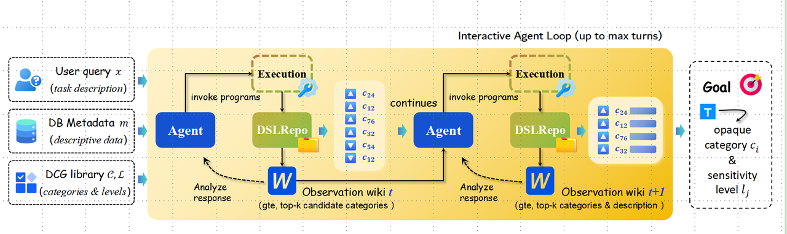

# Data Classify-Grading (DCG)

**An Agentic Framework for Automated Data Classification and Sensitivity Grading of Database Fields**

DCG is an LLM-agent-based system that automatically determines the **data category** and **sensitivity level** of a database field. Given a field (which may be expressed in English, *pinyin*, or an abbreviation), its surrounding database/table metadata, and a domain-specific classification-grading standard corpus (e.g., finance, education, automotive), the agent first expands the semantic meaning of the field, then matches it against a multi-level category taxonomy and a sensitivity-level scale.


---

## Table of Contents

- [Overview](#overview)
- [Task](#task-definition)
- [Method](#method)
- [Datasets](#datasets)
- [Experiments](#experiments)


---

## Overview

- **Task-oriented agent** for data classification and grading, built as a clean, well-structured code repository.
- Handles **real-world field naming ambiguity**: fields can be English names, *pinyin*, or abbreviations — the agent expands semantic meaning before matching labels.
- Covers **four-level category taxonomy** (root → branch → subbranch → leaf) plus a **sensitivity level** for each field.
- Tested on **three public domains**: Finance, Education, and Vehicle.
- **Two-stage post-training pipeline**: Planner-only **SFT** followed by **GRPO reinforcement learning** on top of the **Qwen3.5-9B-Instruct** base model, powered by the **VeRL** training framework.
- Provides a **full evaluation suite**: exact-match, macro/weighted F1, hallucination rates, terminal parse rates, and token-cost statistics.

---

## Task

Given:

- a database **field** `x` (field name, type, description, and example values),
- the surrounding **metadata** `m` (database and table names/descriptions),
- a **corpus** `c` of classification & grading standards (the domain's official category/level definitions), and
- the label space `L` (candidate categories and levels),

the model must output the field's **data category** `c_i` (at the leaf level and its ancestors) and its **sensitivity level** `l_j`.

Because fields are frequently written in English, *pinyin*, or abbreviations, the framework first **expands the semantic meaning** of each field (via dedicated skills), and only then matches it against the classification-grading labels.

```text
Input  : (field x, metadata m, standard corpus c, label space L)
Output : (category c_i, sensitivity level l_j)
```

---

## Method

DCG is an **agentic DSL + program-execution** approach. The agent is built around:

1. **Semantic interpretation** — expand field names/abbreviations into their full meanings using domain knowledge and metadata.
2. **DSL Skill Library** — reusable, composable skills such as *metadata acquisition*, *semantic interpretation*, *standard alignment*, and *evidence reasoning*.
3. **Program generation & execution** — a Planner generates a **program** consisting of ordered steps with state references; the program is executed against the skill library, and candidate categories are retrieved with evidence.
4. **Interactive agent loop** — the agent iterates (bounded by a maximum number of rounds), observing execution results and replanning within a fixed budget when needed.
5. **Post-training** — the Planner is first supervised on real teacher execution trajectories (**DCG-SFT**), then optimized with **GRPO** in the real program-execution environment.




### Baselines

| ID | Name | Description |
|----|------|-------------|
| `NONT-A` | **Base-LLM** | Directly answer category + level from metadata and standards; no skills, no SFT/RL. |
| `NONT-B` | **CoreSkill** | Fixed two-step skill flow: ① retrieve top-5 candidate categories; ② select top-1 with evidence and output category + level. |
| `NONT-C` | **StepSkill** | Step-wise agent over a full skill library: pick one action, read the observation, then decide the next step. |
| `NONT-D` | **ProgSkill** | Program-based orchestration: Planner emits an ordered program and can replan within a fixed budget. No training. |
| `TRAIN-A` | **DCG-SFT** | Same execution framework as ProgSkill, but the Planner is fine-tuned on real teacher trajectories. |
| `TRAIN-B` | **DCGAgent-9B** | SFT initialization + GRPO reinforcement learning in the real program-execution environment. |

---

## Datasets

We release classification-grading datasets for three domains, together with their standard corpora, on Hugging Face:

**DataHub**: [https://huggingface.co/datasets/DocAILab/DCG](https://huggingface.co/datasets/DocAILab/DCG/tree/main)

### Dataset Naming

| Type | Finance | Education | Automotive |
|------|---------|-----------|------------|
| Dataset | `DCG_FIN` | `DCG_EDU` | `DCG_VEH` |
| Corpus  | `DCG_FIN_Corpus` | `DCG_EDU_Corpus` | `DCG_VEH_Corpus` |

### Statistics

**Education (`DCG_EDU`)**

| Split | Samples | Leaf Categories Covered |
|-------|---------|------------------------|
| SFT | 736 | 7 |
| RL Train | 252 | 6 |
| Val | 195 | 7 |
| Test | 300 | 7 |

**Finance (`DCG_FIN`)**

| Split | Samples | Leaf Categories Covered |
|-------|---------|------------------------|
| SFT | 1,000 | 12 |
| RL Train | 1,083 | 9 |
| Val | 422 | 8 |
| Test | 427 | 9 |

**Automotive (`DCG_VEH`)**

| Split | Samples | Leaf Categories Covered |
|-------|---------|------------------------|
| SFT | 1,000 | 40 |
| RL Train | 1,451 | 40 |
| Val | 181 | 22 |
| Test | 181 | 21 |

**Steel (`DCG_STEEL`, currently excluded from experiments)**

| SFT (non-trajectory) | Train | Val | Test | Leaf (L4) | Subbranch (L3) | Branch (L2) | Root (L1) | Corpus Entries |
|----------------------|-------|-----|------|-----------|-----------------|-------------|-----------|----------------|
| 2,200 | 14,521 | 1,926 | 1,946 | 233 | 54 | 15 | 3 | 233 |

---

## Experiments

The main experiments evaluate **model × dataset** across the three domains (Finance, Education, Automotive), with controlled comparisons:

| Contrast | Configs | Question |
|----------|---------|----------|
| C1 – Basic pipeline | `NONT-A` ↔ `NONT-B` | What is the gain of adding a simple retrieve–decide skill flow over direct answering? |
| A1 – Orchestration paradigm | `NONT-C` ↔ `NONT-D` | Program vs. step-wise action selection under matched conditions. |
| A2 – Planner SFT ablation | `NONT-D` ↔ `TRAIN-A` | Does trajectory-supervised fine-tuning of the Planner help? |
| A3 – RL ablation (upcoming) | `TRAIN-A` ↔ `TRAIN-B` | Does GRPO provide additional gains over SFT? |

---
